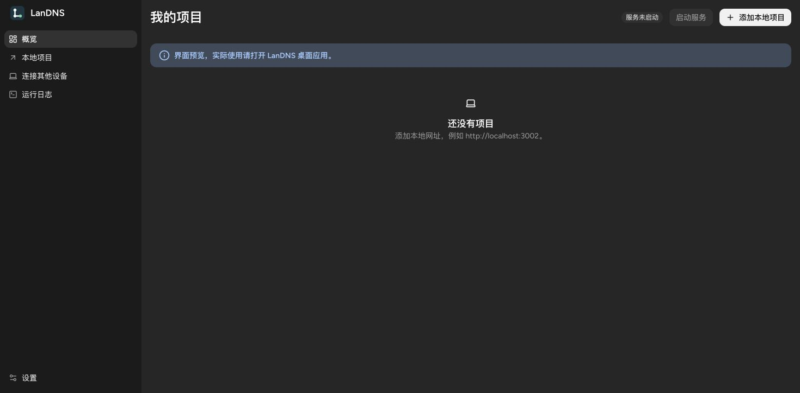
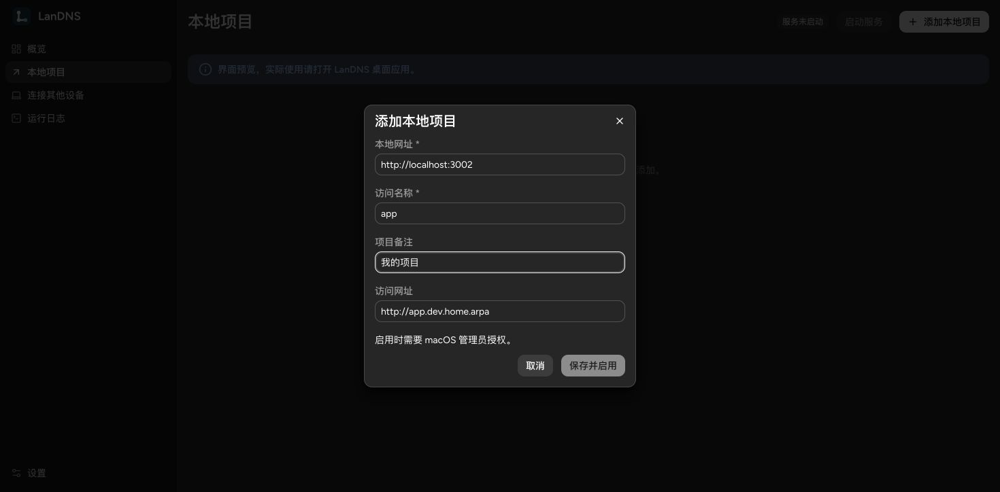
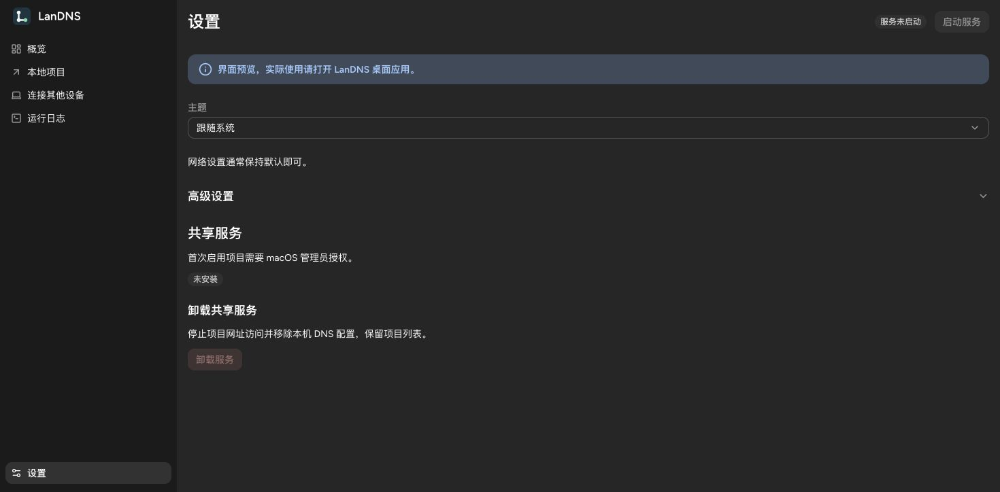

# LanDNS

让手机和其他电脑用好记的域名，访问 Mac 上正在运行的本地项目。

把 `http://localhost:3002` 添加到 LanDNS，给它起名 `app`，就能通过 `http://app.dev.home.arpa` 访问。Mac 会自动配置本机解析；同一局域网里的其他设备完成一次 DNS 设置后，也能使用这个网址。

## 功能介绍

- **一个项目，一个网址**：添加、编辑、停用本地项目，通过名称区分前端、接口服务和其他开发环境。
- **局域网设备访问**：在手机、平板或其他电脑上打开项目，方便真机调试与演示。
- **域名随网络地址更新**：自动识别 Mac 的局域网 IPv4，每 3 秒检查变化，更新解析与监听地址。
- **支持实时开发**：HTTP 转发支持 WebSocket 和流式响应，目标项目可以继续运行在 `localhost` 上。
- **泛域名与默认项目**：支持多级子域名，也可以用 `*` 为未单独配置的名称指定默认项目。
- **后台持续运行**：关闭应用窗口后，共享服务仍继续工作；可在界面中启动、停止或卸载服务。
- **状态与排查**：查看运行日志、网络地址和请求数量，使用 DNS 检测检查域名解析。
- **主题设置**：支持浅色、深色和跟随系统，默认跟随系统，选择会自动保存。
- **应用更新**：手动检查新版本，下载并校验更新包，安装后重启应用。

LanDNS 自带 DNS 服务与 HTTP 代理，使用安装包不需要额外安装 dnsmasq、Caddy 或 Homebrew。

## 页面截图

### 概览

集中查看当前项目，直接打开它的局域网网址。



### 添加本地项目

填写本地网址与访问名称，即可生成项目的局域网网址。



### 设置

切换主题，管理后台服务；网络配置与 DNS 检测收在高级设置中。



## 支持的平台

| 平台 | 支持情况 |
| --- | --- |
| macOS 14 及更新版本 | 支持运行 LanDNS；Universal 安装包同时适用于 Apple Silicon 和 Intel Mac |
| Windows、Linux | 暂不提供桌面安装包；可以作为局域网客户端，用浏览器访问 Mac 共享的项目 |
| iOS、iPadOS、Android | 可以作为局域网客户端，按下方说明配置 DNS 后访问 |

目前的后台服务依赖 macOS 的系统授权、launchd 和 DNS resolver 配置，尚未实现 Windows 服务安装与网络配置。因此自动发布只构建 macOS 安装包。

## 安装与使用

### 安装应用

从项目的 GitHub Releases 下载 `.dmg`，打开后将 **LanDNS** 拖入「应用程序」，再从「应用程序」启动。

当前自动构建使用 ad-hoc 临时签名，尚未经过 Apple 公证。macOS 可能阻止首次打开；确认下载来源可信后，可按系统提示在「系统设置 → 隐私与安全性」中允许打开。签名与公证的区别见 [Tauri macOS 签名说明](https://v2.tauri.app/distribute/sign/macos/)。

### 添加第一个项目

1. 让 Mac 连接 Wi-Fi 或以太网，并启动要共享的项目，确认 `http://localhost:3002` 可以正常打开。
2. 打开 LanDNS，点击「添加本地项目」。
3. 本地网址填写 `http://localhost:3002`，访问网址填写 `app`（使用默认后缀），或填写独立网址，例如 `http://app.dev.test`；项目备注可以留空。
4. 点击「保存并启用」，按 macOS 提示授予管理员权限。
5. 在概览中点击「打开网址」，访问保存的网址；填写 `app` 时，默认是 `http://app.dev.home.arpa`。

本地网址也支持 `http://127.0.0.1:3002`。填写服务的根地址即可，不要附带页面路径或查询参数；打开项目后可以正常访问其子页面。默认网络配置通常无需修改。

LanDNS 负责把网址转发给项目，项目本身仍需保持运行。它不会代替你启动或管理开发服务器。

每个项目的「访问网址」都可以直接编辑，例如分别使用 `http://sub.dev.test` 和 `http://api.example.com`。完整网址固定在当前项目上，仅将这个主机名指向 Mac。访问网址使用 HTTP 默认端口，不包含账号、页面路径、查询参数或锚点。需要默认项目时，填写 `*`，匹配默认后缀下未单独配置的名称。

只填写 `sub` 这样的名称时，网址使用「设置 → 高级设置」中的默认后缀，初始为 `dev.home.arpa`；修改默认后缀会同步改变简写项目和旧项目的网址，已单独设置的完整网址保持不变。开启系统代理时，将独立项目的完整主机名加入代理绕过列表；使用默认后缀的项目则加入所选后缀及 `*.后缀`。

### 让手机或其他电脑访问

1. 让设备与 Mac 连接同一局域网。
2. 打开 LanDNS 的「连接其他设备」，查看 Mac 的局域网地址。
3. 在另一台设备的 Wi-Fi 详情中，把 DNS 改为手动，只填写这台 Mac 的地址。
4. 用浏览器打开项目网址，例如 `http://app.dev.home.arpa`。

修改前记下设备原来的 DNS 设置，停止使用时恢复为自动获取。不要混用公共 DNS 作为备用地址，否则项目域名可能被交给其他服务器查询。

如果希望局域网中的设备统一接入，可在路由器的局域网 / DHCP 设置中，将下发的 DNS 服务器设为这台 Mac。建议同时为 Mac 设置 DHCP 地址保留。LanDNS 不会自动修改路由器。

**Mac 的 IP 变化后，域名会自动更新，但其他设备填写的 DNS 地址也需要同步更新。** Mac 睡眠、关机或断网时，共享项目不可用；把它作为唯一 DNS 的设备也可能暂时无法解析普通网站。

### 停止、更新与卸载

- **关闭窗口**：后台服务继续运行。已启用的服务会由 macOS 管理，并在开机后启动。
- **停止服务**：暂停项目访问，移除 LanDNS 的本机解析配置，并停用服务的开机运行，直到再次启动。
- **更新应用**：在「设置 → 应用更新」点击「检查更新」，发现新版后点击「下载安装」。运行中的共享服务会同步更新，然后自动重启应用，macOS 可能请求管理员授权；项目列表与设置会保留。取消服务授权或手动替换应用后，设置页会提示「更新共享服务」，可继续完成同步。
- **卸载服务**：在「设置」中点击「卸载服务」，移除后台程序与本机解析配置，保留项目列表。之后可以删除应用。

安装、更新、停止和卸载后台服务时，macOS 可能要求管理员授权。卸载前，请恢复其他设备或路由器上为 LanDNS 修改的 DNS 设置。

首次需要手动安装包含「应用更新」功能的版本，之后即可在应用内更新。更新来源为本项目的 [GitHub Releases](https://github.com/xiaotianna/LanDNS/releases)，安装前会验证更新包签名。

## 本地启动

### 准备环境

在 macOS 上安装以下工具：

| 工具 | 要求 |
| --- | --- |
| [Node.js](https://nodejs.org/) | 推荐 Node.js 24，使用自带的 npm |
| [Rust](https://rustup.rs/) | stable 工具链，至少 1.90；当前锁定的依赖需要此版本 |
| Xcode Command Line Tools | 提供 macOS 编译和链接工具 |

安装 Xcode Command Line Tools：

```sh
xcode-select --install
```

如果已经安装 Rust，可以更新 stable 工具链：

```sh
rustup update stable
```

进入项目目录后，安装依赖并启动桌面开发窗口：

```sh
npm ci
npm run tauri -- dev
```

Tauri 会自动启动 Vite，再打开原生桌面窗口，不需要另外运行一份前端开发服务。初次启动需要下载并编译 Rust 依赖，耗时会比后续启动更长。

如果只想预览界面，可以单独运行：

```sh
npm run dev
```

浏览器地址是 `http://127.0.0.1:1420`。浏览器预览不能安装或管理系统服务；验证实际共享功能需要使用 Tauri 桌面窗口。两种启动方式都使用 1420 端口，不要同时运行。

日常检查可使用：

```sh
npm run check
cargo check --manifest-path src-tauri/Cargo.toml
```

## 本地打包

打包需要在 Mac 上进行，使用与本地启动相同的开发环境。Tauri 会自动构建前端，再生成应用和安装包。

更新签名私钥存放在本机 `~/.tauri/landns-updater.key`，以下示例通过环境变量提供私钥路径。私钥必须与 `src-tauri/tauri.conf.json` 的 `plugins.updater.pubkey` 配对；若私钥设置了密码，还需提供 `TAURI_SIGNING_PRIVATE_KEY_PASSWORD`。请妥善备份私钥，并保持后续版本使用同一密钥，勿将私钥提交到仓库。

### 打包当前 Mac 的架构

```sh
npm ci
TAURI_SIGNING_PRIVATE_KEY="$HOME/.tauri/landns-updater.key" \
APPLE_SIGNING_IDENTITY=- npm run tauri -- build --bundles app,dmg -- --locked
```

产物位置：

| 产物 | 路径 |
| --- | --- |
| 应用 | `src-tauri/target/release/bundle/macos/LanDNS.app` |
| DMG 安装包 | `src-tauri/target/release/bundle/dmg/` |

Apple Silicon Mac 默认生成 ARM64 版本，Intel Mac 默认生成 x86_64 版本。

### 打包 Universal 通用版本

通用版本可以同时安装在 Apple Silicon 和 Intel Mac 上，也是自动发布使用的方式。

```sh
rustup target add aarch64-apple-darwin x86_64-apple-darwin
TAURI_SIGNING_PRIVATE_KEY="$HOME/.tauri/landns-updater.key" \
APPLE_SIGNING_IDENTITY=- npm run tauri -- build --target universal-apple-darwin --bundles app,dmg -- --locked
```

通用版本的产物位于：

```text
src-tauri/target/universal-apple-darwin/release/bundle/macos/LanDNS.app
src-tauri/target/universal-apple-darwin/release/bundle/dmg/
```

`APPLE_SIGNING_IDENTITY=-` 使用 ad-hoc 签名，不需要 Apple 开发者证书，但不代表经过 Apple 验证或公证。正式面向其他用户分发时，应配置 Developer ID 签名与公证凭据，替换工作流中的临时签名设置，具体步骤见 [Tauri macOS 签名与公证教程](https://v2.tauri.app/distribute/sign/macos/)。

## 发布版本与自动构建

项目包含 [发布工作流](.github/workflows/release.yml)。配置更新签名后，推送版本 tag 就会自动构建 macOS Universal 安装包，并创建已发布的 GitHub Release，上传安装包、签名更新包和 `latest.json` 更新清单。

### 1. 配置更新签名

在 GitHub 仓库的 **Settings → Secrets and variables → Actions → Repository secrets** 中添加：

- `TAURI_SIGNING_PRIVATE_KEY`：本机 `~/.tauri/landns-updater.key` 文件的完整内容，填写内容而非本机路径。
- `TAURI_SIGNING_PRIVATE_KEY_PASSWORD`：私钥密码；未设置密码时可不添加。

工作流会在缺少私钥时提前停止，并给出配置提示。更新包使用独立的 Tauri 签名进行来源校验，详见 [Tauri 更新签名说明](https://v2.tauri.app/plugin/updater/#signing-updates)。

应用读取 `https://github.com/xiaotianna/LanDNS/releases/latest/download/latest.json`；如将项目发布到其他仓库，需要同步修改 `src-tauri/tauri.conf.json` 的 `plugins.updater.endpoints`。

### 2. 确认安装包版本

安装包版本取自 `src-tauri/tauri.conf.json`。需要升级应用版本时，将以下位置同步更新，例如 `0.1.0`：

- `package.json` 的 `version`。
- `package-lock.json` 顶层及 `packages[""]` 中的 `version`。
- `src-tauri/tauri.conf.json` 的 `version`。
- `src-tauri/Cargo.toml` 中应用包的 `version`。
- `src-tauri/Cargo.lock` 中 `name = "dns-x"` 对应的版本条目。

内部 Rust 包名仍为 `dns-x`；更新版本时，只修改该包的条目，不要修改依赖包的版本。

以 `v` 开头的 tag 会触发构建，Release 名称使用该 tag。应用仅提示高于当前安装版本的更新，因此每次发布都应增加版本号。

### 3. 推送 tag

确认要发布的代码和工作流已提交，且远程仓库已配置为 `origin`，再手动执行：

```sh
git tag -a v0.1.0 -m "LanDNS v0.1.0"
git push origin v0.1.0
```

创建本地 tag 本身不会触发构建，推送到 GitHub 后才会触发。后续版本使用新的版本号和 tag。

### 4. 获取安装包

在 GitHub 的 **Actions → Release macOS** 中查看构建进度。构建成功后，在 **Releases** 中找到对应版本，下载 Universal `.dmg`；一个安装包即可覆盖两种 Mac 架构。

默认工作流使用 GitHub 提供的 `GITHUB_TOKEN` 创建 Release，无需配置个人访问令牌。仓库或组织策略需要允许工作流使用 `contents: write` 权限。工作流需要上面配置的 Tauri 更新签名 secret；macOS 应用仍使用 ad-hoc 临时签名，尚未经过 Apple 公证。

## 常见问题

| 问题 | 检查方法 |
| --- | --- |
| 服务无法启动 | 查看运行日志，确认 53 和 80 端口未被其他服务占用，并完成管理员授权 |
| Mac 能访问，手机不能访问 | 确认同一网段、设备 DNS 指向 Mac，且 macOS 防火墙允许 LanDNS 接收入站连接；访客 Wi-Fi 或设备隔离也可能阻止访问 |
| 域名偶尔无法打开 | 检查公共备用 DNS、VPN、系统私有 DNS 或浏览器安全 DNS 是否绕过了本地解析 |
| 项目提示主机名不被允许 | 在目标项目的主机名白名单中加入项目域名，例如 Vite 的 `server.allowedHosts` |
| 使用代理软件后无法访问 | 将 `dev.home.arpa` 和 `*.dev.home.arpa` 加入代理绕过列表；更改域名后也要更新列表 |
| DNS 检测通过，但网页打不开 | DNS 检测只检查解析；继续确认目标项目在本机运行、端口正确且可以通过 localhost 访问 |

当前支持 IPv4 和 HTTP，未提供 HTTPS 证书或 IPv6 接入；监听范围限于本机回环地址与所选局域网地址，仅接受同网段连接。默认 DNS 缓存时间为 15 秒，IP 切换时现有连接会断开并需要重连。

用户项目配置保存在 `~/Library/Application Support/app.dnsx.desktop/config.json`。后台服务使用 `/Library/Application Support/DNS X/`、`/Library/LaunchDaemons/app.dnsx.service.plist` 和带有应用标记的 `/etc/resolver/` 文件。
